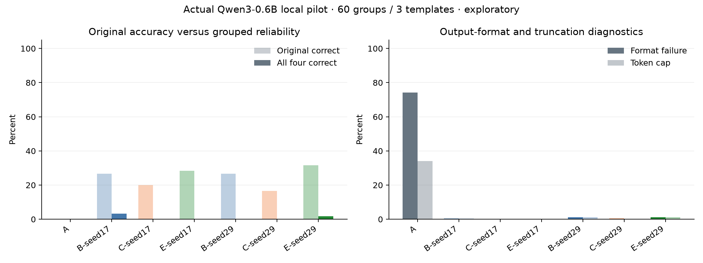
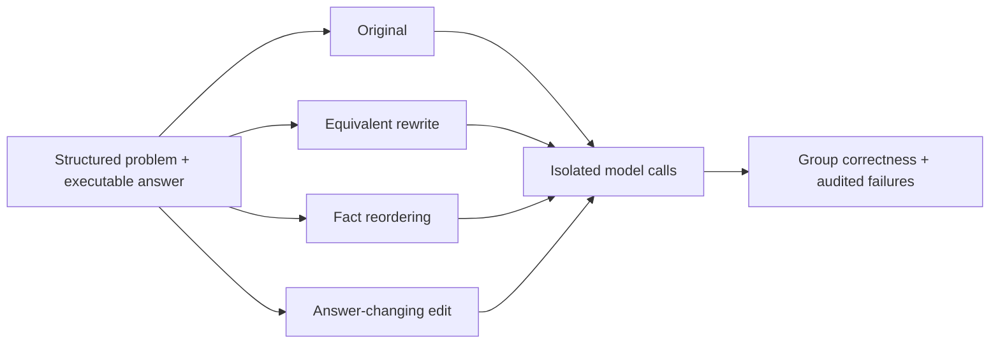

# Semantic Shift Lab

**When should a language model keep its answer — and when should it change it?**

[中文说明](README.zh-CN.md) · [Research protocol](docs/PROTOCOL.md) · [Failure cases](docs/FAILURE_CASES.md) · [Data card](docs/DATA_CARD.md) · [Validation](docs/VALIDATION.md)

A reproducible research **pilot** for studying answer invariance under meaning-preserving rewrites and correctness under meaning-changing edits. Includes a dependency-free evaluation pipeline, synthetic arithmetic data, explicit failure injection, optional Hugging Face inference, and LoRA SFT experiments.

> **Research status (v0.2.0):** A real exploratory Qwen3-0.6B CPU study is complete: six LoRA fits, two seeds, seven evaluations and 1,680 saved test outputs. No reliable superiority or novel-method claim is established. `research/` contains actual outputs; `examples/` contains separately labeled synthetic fixtures. Data received assistant template review, not independent human review.

## Observed local pilot

Read the [Chinese research report](research/local-pilot-fp32/REPORT.zh-CN.md), [complete seed-level results](research/local-pilot-fp32/RESULTS.md), [observed failures](research/local-pilot-fp32/OBSERVED_FAILURES.md), and [reproduction instructions](research/README.md).

| Training data | Original accuracy, two-seed mean | All four correct, two-seed mean |
|---|---:|---:|
| B: originals | 26.7% | 1.7% |
| C: originals + rewrites + reorderings | 18.3% | 0.0% |
| E: all four variants | 30.0% | 0.8% |

The planned E−C comparison differs by only one successful group in one seed. There are just 60 test groups and three test templates; these descriptive means reuse the same test groups. The untrained baseline scored zero under an answer-only protocol with substantial formatting/truncation failures. This does not show an inability to do arithmetic. Prior baseline outcomes had been inspected before a documented precision change, so the completed rerun is explicitly exploratory. Arm D was not run.



## The question

| Input | Expected answer |
|---|---:|
| Lin has 18 cards, receives 7, then gives away 5. | 20 |
| Starting with 18 cards, Lin is given 7 before handing 5 to a friend. | 20 |
| Lin has 18 cards, gives away 7, then gives away 5. | 6 |

Consistency alone is insufficient: a model can be consistently wrong. Changing an answer is also insufficient: the changed answer must be correct.



## Start in 30 seconds — no dependencies or GPU

From the repository root, with Python 3.10+:

```bash
python -m semantic_shift demo --output runs/demo
python -m unittest discover -s tests -v
```

Open `runs/demo/fault-injector/report.md`. The report is visibly marked **DEMONSTRATION ONLY**. It exercises reporting with intentionally injected errors. It says nothing about an LLM's ability.

Optionally install the CLI:

```bash
python -m pip install -e .
semantic-shift --help
```

## Generate and audit data

```bash
python -m semantic_shift generate --per-template 20 --seed 17 --output runs/data.jsonl
python -m semantic_shift validate --data runs/data.jsonl
```

This creates 180 groups / 720 records across nine templates. Every group has four variants. Three templates belong to each split; broad task families appear in all splits. This is **template-ID separation, not proof of algebraic or linguistic independence**. See the [data card](docs/DATA_CARD.md).

Review all pilot examples, record reviewer decisions, and set `review_status` to `approved` only after review. Freeze the resulting file before inference. Fingerprints detect subsequent changes. Structural validation cannot verify that a natural-language rewrite preserves meaning.

## Run a real model

Install optional dependencies into your chosen environment:

```bash
python -m pip install -e '.[hf]'
```

Select a compatible **text chat model**, verify its license, and copy its immutable Hub commit SHA. These commands use shell variables you set to real values:

```bash
MODEL_ID='your-org/your-chat-model'
MODEL_REVISION='replace-with-40-character-model-commit-sha'
python -m semantic_shift run --data runs/data.jsonl --output runs/model-a   --backend hf --model "$MODEL_ID" --revision "$MODEL_REVISION"   --device cpu --split test --max-new-tokens 256
python -m semantic_shift evaluate --data runs/data.jsonl --run runs/model-a
```

Use `--device mps` or `--device cuda` only when available. The simple backend loads unquantized float32 weights, uses batch size one and greedy decoding, and has no quantization or distributed support. Start small; model weights plus training state can exceed device memory. No answer/program/group label is sent to a real model, and each example is an independent conversation.

For local snapshots, content-pin the directory instead:

```bash
MODEL_ID='/path/to/local/model'
MODEL_REVISION=$(python -m semantic_shift model-revision --model "$MODEL_ID")
```

Local hashing reads model files and may take time. Changes to model or tokenizer files invalidate the hash.

## Run the training study

| Arm | Training data | Status |
|---|---|---|
| A | No additional training | Run the unmodified checkpoint |
| B | Original questions | Implemented |
| C | Original + equivalent rewrite + reorder | Implemented |
| D | Original + answer-changing edit | Implemented |
| E | All four variants | Implemented |

Edit a copy of `configs/E.json`: set `model`, immutable `revision`, `device` and budgets. Configurations are explicit placeholders, not tuned recipes.

```bash
python -m semantic_shift export-sft --data runs/data.jsonl --condition E --output runs/E-sft.jsonl
python -m semantic_shift train --data runs/data.jsonl --config configs/E.json --output checkpoints/E-seed17
python -m semantic_shift run --data runs/data.jsonl --output runs/E-seed17   --backend hf --model "$MODEL_ID" --revision "$MODEL_REVISION"   --adapter checkpoints/E-seed17 --device cpu
python -m semantic_shift evaluate --data runs/data.jsonl --run runs/E-seed17
```

Training masks prompt tokens, refuses silently truncated labels, stops on a total processed-token budget (or a step safety cap), and records actual tokens, supervised tokens, examples seen and library versions. Budget overshoot is at most one example. LoRA adapters are saved separately and checked against the base model on reload.

**These default arms are a pilot, not a complete controlled comparison.** They differ in unique examples and supervision types. Add a diversity-matched original-data baseline, equalized sampling controls, multiple seeds and independent external data before attributing gains to a method. See [PROTOCOL.md](docs/PROTOCOL.md).

## What gets measured

- **Original accuracy:** original question correct.
- **Invariant all-correct:** original, paraphrase and reorder all correct.
- **Edit-pair correct:** original and answer-changing edit both correct.
- **Group all-correct:** all four variants correct; primary planned endpoint.
- **Format/parser failure rate:** no valid integer could be extracted.
- **Token total and coverage:** missing usage data stays missing, not zero.

Every report includes an exploratory percentile bootstrap over template IDs. Only three test templates ship: these intervals are **not reliable evidence of population generalization**, and do not measure training-seed variance.

Reports include `summary.json`, `report.md` and `errors.jsonl`. Raw predictions and run metadata are preserved. Missing/duplicate predictions, incomplete runs, changed datasets and overwritten output directories are rejected.

## Repository map

```text
semantic_shift/  Generation, validation, inference, scoring, training, CLI
research/        Actual model runs, frozen data, failures, analysis and reproduction
configs/         B/C/D/E SFT configurations
examples/        Small synthetic fixture and its explicitly labeled report
tests/           Core regression tests and opt-in real-library integration
docs/            Protocol, data card, failure cases, validation, publication guide
.github/         Core test workflow
```

## Real-library smoke test (no model download)

```bash
RUN_HF_INTEGRATION=1 python -m unittest discover -s tests -p test_hf_integration.py -v
```

This creates a tiny random GPT-2 model and local tokenizer, runs inference, performs LoRA updates, saves/reloads the adapter and verifies provenance. It tests software plumbing, **not reasoning performance**. See [tested versions](docs/VALIDATION.md).

## Related work and scope

- [CheckList — ACL 2020](https://aclanthology.org/2020.acl-main.442/): behavior-focused evaluation, including invariance tests.
- [GSM-Symbolic](https://arxiv.org/abs/2410.05229): controlled mathematical question variations.
- [GSM-Plus](https://github.com/qtli/GSM-Plus): robust mathematical reasoning data and evaluation; consult its own license before use.
- [RoParQ](https://arxiv.org/abs/2511.21568): paraphrase-aware alignment.
- [Learning Rewrite-Invariant Reasoning with Targeted Alternation Training — ICML 2026](https://proceedings.mlr.press/v306/arraf26a.html).
- [Counterfactual Sensitivity Regularization — Findings of EMNLP 2026](https://aclanthology.org/2026.findings-emnlp.539/): edits to reasoning traces; this pilot edits problem statements.

Combining known testing ideas is not automatically a novel contribution. The planned study asks whether a controlled training comparison reveals a reproducible trade-off and when it transfers. Negative results belong in the report.

## License and release

Original code and synthetic templates: [MIT](LICENSE). External model/data licenses remain separate. The source archive includes original synthetic data and real prediction logs, but no base-model weights or credentials. A separate optional adapter archive contains the six trained LoRA adapters with provenance. See [publishing instructions](docs/PUBLISHING.md) and [contribution guidelines](CONTRIBUTING.md).
