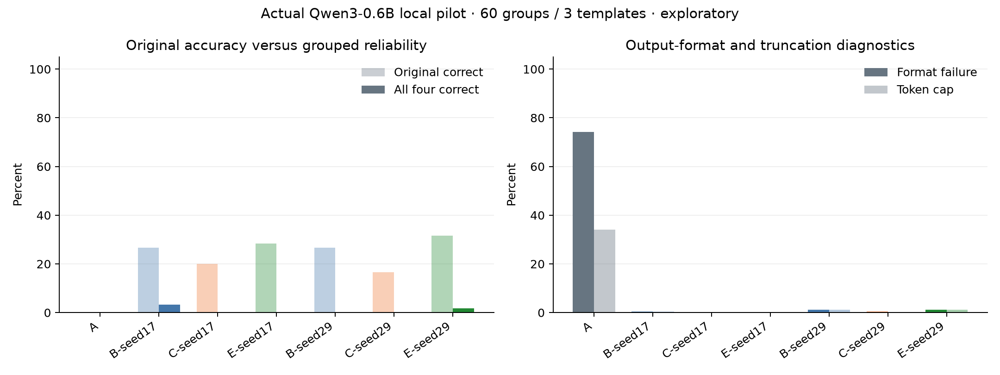

# Semantic Shift Lab：LLM 什么时候应该保持或改变答案？

[English README](README.md) · [研究协议](docs/PROTOCOL.md) · [失败案例](docs/FAILURE_CASES.md)

这是一个用于博士申请、研究实习和后续研究的 **LLM 实验起点**，提供可运行的代码，而非已经完成的论文。

**已完成真实本机探索实验：Qwen3-0.6B、6 次 LoRA 训练、2 个种子、7 组评估、1,680 条测试输出，云计算费用为 0。尚无可靠的模型优越性结论。**

[完整中文研究报告](research/local-pilot-fp32/REPORT.zh-CN.md) · [真实失败案例](research/local-pilot-fp32/OBSERVED_FAILURES.md) · [逐种子结果](research/local-pilot-fp32/RESULTS.md) · [复现说明](research/README.md)

| 训练方法 | 原题正确率：两种子平均 | 四题全对率：两种子平均 |
|---|---:|---:|
| B：原题 | 26.7% | 1.7% |
| C：原题＋改写＋重排 | 18.3% | 0.0% |
| E：再加入关键事实编辑 | 30.0% | 0.8% |

E 相对 C 的主指标差异仅来自一个种子中的一个题组，不能据此声称可靠优势。测试只有 60 个题组、3 个模板，两个种子重复使用同一测试集；未训练基线有严重格式与截断问题。精度修订前已看过旧基线，本轮明确属于探索性实验。D 组未运行。

`research/` 保存真实输出；`examples/` 仍是人为注入错误的演示数据，两者分开报告。数据接受了助手模板审核，没有独立人工语义审核。



## 研究问题

“收到 7 张卡片”换一种说法，答案应保持正确；将“收到”改为“送出”，答案应正确改变。我们比较不同数据增强与后训练条件下，模型能否兼顾这两种能力。

| 实验组 | 内容 |
|---|---|
| A | 原始指令模型，不再训练 |
| B | 原题 SFT |
| C | 原题＋等价改写＋事实重排 |
| D | 原题＋关键事实编辑 |
| E | 混合以上数据 |

这些策略本身不是新算法。研究价值取决于是否做出可信的受控比较、发现边界，并排除数据量、预算和评估器等替代解释。

## 直接运行

在仓库根目录，Python 3.10 以上即可运行，无需安装第三方库：

```bash
python -m semantic_shift demo --output runs/demo
python -m unittest discover -s tests -v
```

查看 `runs/demo/fault-injector/report.md`：包含四项成组指标、格式失败率和明确的演示标记。

生成正式实验前的待审核数据：

```bash
python -m semantic_shift generate --per-template 20 --seed 17 --output runs/data.jsonl
python -m semantic_shift validate --data runs/data.jsonl
```

默认生成 180 组、720 道题。九个模板划入训练／验证／测试，各三种。**模板 ID 不重叠不代表抽象运算或语言结构完全不重叠。** 初步数据规模小、题目简单，可能出现天花板或地板效应；本次实验出现了严重地板效应。

## 接入模型与训练

激活你自己的 Python 环境后：

```bash
python -m pip install -e '.[hf]'
```

英文 README 提供完整的 Hugging Face 推理、LoRA 训练和适配器重载命令。模型版本必须固定：Hub 模型使用 40 位 commit SHA，本地模型使用 `model-revision` 计算出的目录 SHA256。

先运行小模型，确认显存／内存足够。通用推理实现为未量化 float32、单设备、batch size 1；不是量化或大规模分布式训练框架。可选择 `cpu`、`mps`、`cuda`，以实际检测到的设备为准。

`configs/B.json` 至 `configs/E.json` 需要填写模型、版本和设备。训练只读 `train` 数据，屏蔽提示词部分的训练标签，不会默默截断答案。每次记录实际 token、步数、覆盖样本、库版本和数据哈希。

研究专用脚本使用 CPU float32、batch size 8，按冻结协议执行。用该脚本复现本次结果，通用 CLI 的默认提示与解码配置不同。

## 失败案例怎么讲

已观测案例见[实测失败报告](research/local-pilot-fp32/OBSERVED_FAILURES.md)。此外，仓库另提供四种**设计示例**及分析方法：

1. 忽略关键事实变化，继续输出旧答案。
2. 关系表述改变后，将“多／少”方向读反。
3. 数据生成器将“每盒”错写为“总共”，产生错误标签。
4. 模型输出正确，但严格数字解析器拒绝自然语言答案。

还有需要通过实验验证的方法失败：收益被数据量控制解释；训练内提高但未见结构不提高；没有观察到最初假设的权衡。

只把真实运行中保存的输出称为“实验发现”。演示用错误不能写入简历当作真实研究结果。

## 在会议前完成什么

- 第 1–2 天：阅读相关工作，冻结假设、指标和划分。
- 第 3–4 天：人工核验数据，补充有挑战性的模板。
- 第 5–6 天：运行基础模型，审核格式失败与算错案例。
- 第 7–9 天：资源允许时跑 B/C/E 初步对照；资源不足时扩展评估。
- 第 10 天：整理真实结果、一张图、限制和下一步实验。

项目的强项应是可复查的问题与证据。正式比较还需要更多独立模板、数据多样性控制、多随机种子和外部测试。

## 发布到 GitHub

仓库已经包含英文首页、中文说明、MIT 许可证、核心 CI 测试、研究协议和失败案例文档。按照 [发布步骤](docs/PUBLISHING.md) 创建仓库即可；本项目文件生成过程没有自动替你发布到 GitHub。

发布前更新作者／联系方式，并检查需要分享的实验输出是否完整且经过语义审核。`runs/` 和 `checkpoints/` 默认忽略，避免误提交大模型文件与临时结果。
