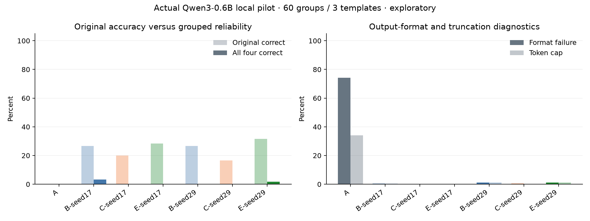
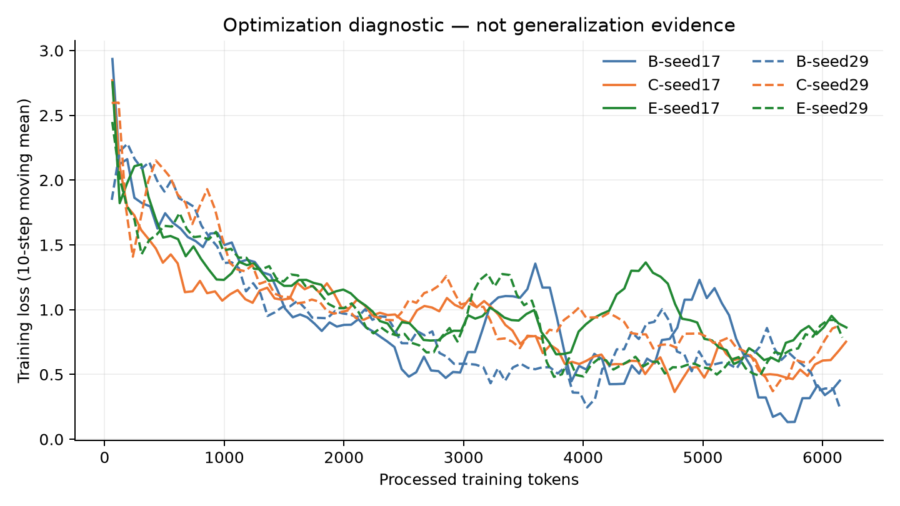

# 本机真实研究报告：语义改写稳健性与事实敏感性

**状态：完成一轮真实模型探索性实验。没有租用服务器，云计算费用为 0。**

这是一项小规模研究试验，包含实际模型预测、六次 LoRA 训练、两个随机种子和失败分析。它尚不能证明新方法优于现有研究，也不是已经通过同行评审的论文。

## 实验设置

- 模型：Qwen3-0.6B，固定版本 `c1899de289a04d12100db370d81485cdf75e47ca`。
- 设备：Apple M1、16 GB 内存；当前执行环境无法使用 MPS，使用四线程 CPU、float32。
- 数据：180 个题组、720 道合成题；训练、验证、测试各 60 组，每组四种变体。只有三个测试模板。
- 每个训练组预算：6,144 个输入＋目标 token，允许最后一个样本造成小幅超额；LoRA rank 8，q/v 投影，学习率 1e-4。
- B：原题；C：原题＋等价改写＋重排；E：原题＋改写＋重排＋关键事实编辑。每组两个种子：17、29。
- 统一关闭 thinking，要求只输出整数，贪心生成，最多 16 个新 token。每个实验都使用同样的测试题与排序。
- 数据由助手检查模板，没有独立人工语义审核。生成数据不等于不存在预训练污染。

## 结果：完整报告所有种子

| 实验 | 原题正确 | 等价组三题全对 | 原题＋事实编辑全对 | 四题全对（主指标） | 格式失败 |
|---|---:|---:|---:|---:|---:|
| A | 0.0% | 0.0% | 0.0% | 0.0% | 74.2% |
| B-seed17 | 26.7% | 3.3% | 18.3% | 3.3% | 0.4% |
| B-seed29 | 26.7% | 0.0% | 16.7% | 0.0% | 1.2% |
| C-seed17 | 20.0% | 1.7% | 5.0% | 0.0% | 0.0% |
| C-seed29 | 16.7% | 0.0% | 3.3% | 0.0% | 0.4% |
| E-seed17 | 28.3% | 3.3% | 1.7% | 0.0% | 0.0% |
| E-seed29 | 31.7% | 1.7% | 20.0% | 1.7% | 1.2% |

## 两个种子的描述性平均

| 方法 | 原题正确 | 等价组三题全对 | 原题＋事实编辑全对 | 四题全对 |
|---|---:|---:|---:|---:|
| B | 26.7% | 1.7% | 17.5% | 1.7% |
| C | 18.3% | 0.8% | 4.2% | 0.0% |
| E | 30.0% | 2.5% | 10.8% | 0.8% |

预先指定的主比较 E−C，四题全对率的两种子平均差为 **+0.8 个百分点**。这个平均值使用同一批 60 个题组，不能当成 120 个独立题组。

各随机种子的配对差：
- E-seed17 minus C-seed17：+0.0 个百分点；按三个模板重采样的探索性区间为 [+0.0, +0.0]。
- E-seed29 minus C-seed29：+1.7 个百分点；按三个模板重采样的探索性区间为 [+0.0, +5.0]。

三个模板不足以可靠估计广泛任务分布的不确定性；以上区间不支持“已证明显著优越”的说法。

## 能得出什么

1. 可以报告本次固定模型、数据、训练预算和解码设置下的实际差异，以及哪些题目在等价改写后失败。
2. 原题分数与成组可靠性差距明显，展示了单一表述测试可能遗漏的行为。成组全对标准本来就更严格；这不是新机制的证明。
3. 本次 E 的主指标两种子平均为 0.8%，C 为 0%，B 为 1.7%。E−C 的差异只来自一个种子中的一个题组，未提供混合增强可靠占优的证据。

## 不能得出什么

- 未训练基线存在严重地板效应。答案格式和 16-token 截断会影响得分，不能将基线 0 分解释为模型完全不会算术。
- A 到训练组的改善混合了格式学习与任务学习，不能全部称为推理能力提高。
- 不同组的独立样本数量、原题曝光次数、监督目标 token 数不同；总 token 相近不等于控制了所有变量。
- 事实编辑配对指标包含原题正确性。它下降可能部分来自原题退步，不能直接证明模型“过度追求不变性”。
- 一个小模型、三个测试模板、两种子和很小的训练预算不能支持普遍结论或顶会水平的有效性宣称。

## 真实失败案例与协议修订

完整原文、选择规则与条件错误率见 [真实失败案例](OBSERVED_FAILURES.md)。B 的两个种子中，各有 16 道原题答对，其中各有 13 道在等价改写后答错。本次所有运行在 comparison 与 groups 两个测试模板上的原题正确率均为 0%；不能将这一结果推广到整个题型。

### 评分器把正确答案判错

初始验证集 12 个长回答中，8 个未截断输出都写出了正确数学答案，但严格 `FINAL:` 格式评分全部判错。另 4 个回答触及 96-token 上限。具体例子：98−4＋11=105，模型输出 `\boxed{105}`，随后字面写出 `FINAL: <integer>`。审核者为助手，未声称独立人工一致性。
原始记录见 [测量失败诊断](../local-pilot/development/MEASUREMENT_FAILURE.md)。这促使我们在最初测试之前统一改用整数输出协议；该协议本身又表现出地板效应，因此报告保留了这一限制。

### 原题答对，等价改写答错

B-seed17 的一个真实题组：43 张卡片，先收到 2 张，再收到 12 张，正确答案 57。原题输出 57；等价改写输出 49；重排输出 57。把第二次“收到 12 张”改为“送出 12 张”后，模型输出正确的 33。该案例说明失败可以出现在表述变化中，但不能仅凭这一例断定内部原因。

### 运行环境失败

初始未显式指定精度时，Transformers 加载了 bfloat16 权重。训练记录到第 10 步后长时间无进展，最终中断在 backward；不能把日志间隔直接当成活跃计算时间，因为设备可能休眠。显式 float32 的三步基准成功，随后完成本轮全部训练。
原 bfloat16 基线与失败记录保留在 [原始轮次](../local-pilot/)。本轮重跑前已看过上一轮基线，因此本轮明确标为工程修订后的探索性实验，不是新的盲测确认实验。

## 训练和计算成本

| 训练运行 | 步数 | 实际总 token | 监督 token | 不同样本数 | 训练秒数 |
|---|---:|---:|---:|---:|---:|
| B-seed17 | 99 | 6145 | 424 | 60 | 95.7 |
| B-seed29 | 99 | 6149 | 425 | 60 | 95.3 |
| C-seed17 | 100 | 6197 | 428 | 100 | 97.6 |
| C-seed29 | 99 | 6147 | 423 | 99 | 109.8 |
| E-seed17 | 100 | 6200 | 423 | 100 | 94.6 |
| E-seed29 | 99 | 6166 | 425 | 99 | 91.2 |

本轮各阶段记录的训练＋推理时间合计约 18.2 分钟，不含下载、诊断、休眠和人工分析时间。未产生服务器租赁费用。

## 下一轮最值得做的改进

1. 在独立开发集上选定不会大面积截断的解码和明确答案提取规则，冻结后再使用新的测试集。
2. 增加独立模板和外部题目，安排独立人工语义审核；不能只换数字扩大“样本数”。
3. 加入数据多样性匹配的普通 SFT 基线，控制原题曝光与监督 token，再研究 E−C 的差异。
4. 增加训练预算、随机种子和第二模型家族；先做规模试验，再决定是否值得使用 GPU 服务器。

## 复现与证据

- [英文数值报告](RESULTS.md)、[机器可读结果](analysis.json)、[冻结协议](preregistration.json)。
- 每个运行目录保留全部原始输出、错误记录、模型版本和提示指纹；`training/` 保留训练清单与逐步损失。
- 按 [研究复现说明](../README.md) 运行下载、训练和分析脚本。
- 测试结果与失败样例都是真实模型输出；仓库 `examples/demo-run/` 仍是单独标注的人工演示数据，未参与本报告。
